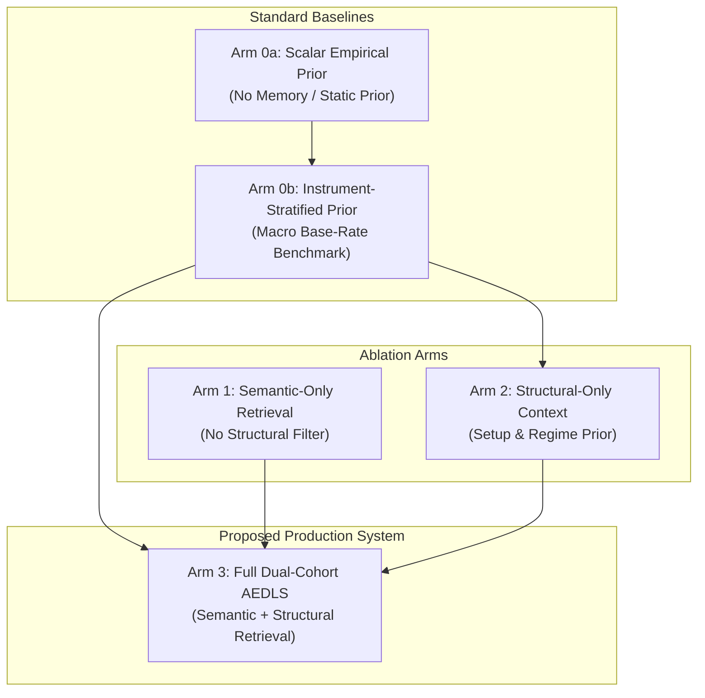

# AEDLS Phase 3 — Protocol Addendum v3.3: Statistical Power Assessment, Class-Count Gates & Prospective Execution Architecture

**Date**: 2026-10-14  
**Author**: Quantitative Architecture & Research Team  
**Review Status**: Formal Senior Quant Addendum v3.2 Review Accepted — Authorizes Stage A (Prospective Memory Accumulation) & Stage B (Calibration)  
**Execution Authority**: Live Veto strictly **PROHIBITED** (`appliedConfidenceDelta = 0`); Phase 4 ML Model Promotion **GATED**  
**Predecessors**:
- [Phase 3 Ablation Protocol (v3.0)](file:///c:/Users/Kulwinder%20Singh/Desktop/personal/AI%20Quant%20Lab/docs/2026-10-14-aedls-phase3-ablation-protocol.md)
- [Protocol Addendum v3.1](file:///c:/Users/Kulwinder%20Singh/Desktop/personal/AI%20Quant%20Lab/docs/2026-10-14-aedls-phase3-protocol-addendum-v3.1.md)
- [Protocol Addendum v3.2](file:///c:/Users/Kulwinder%20Singh/Desktop/personal/AI%20Quant%20Lab/docs/2026-10-14-aedls-phase3-protocol-addendum-v3.2.md)
- [Phase 3 Evaluation Harness Report](file:///c:/Users/Kulwinder%20Singh/Desktop/personal/AI%20Quant%20Lab/docs/2026-10-14-aedls-phase3-harness-report.md)

---

## 1. Senior Quant Review Verdict & Governance Disposition

The diagnostic conclusions of Addendum v3.2 are accepted:
1. **Root Cause Certified**: The absence of active semantic rejections in Development is proven to be caused by strict Point-in-Time availability boundaries ($\max(t_{\text{close}}, t_{\text{evidence}}, t_{\text{review}}, t_{\text{embedding}}) < T_{\text{decision}}$) yielding an empty historical retrieval corpus for early historical data, collapsing dual-cohort estimates back to the development prior ($\bar{p}_{\text{dev}} = 0.4891$).
2. **Structural Attribution Clarified**: Arm 0b (Instrument-Stratified Prior) reproduces the entire measured Arm 2 Brier score improvement in the historical development sample ($BS = 0.247090$). Arm 0b is hereby codified as a **mandatory required benchmark**, not an optional diagnostic.
3. **Statistically Inconclusive Validation**: The Validation partition ($N=20$) remains under mandatory statistical hold (`MODEL_INCONCLUSIVE`). Lowering the 40-episode threshold is strictly forbidden.
4. **Historical Holdout Batch 1 Sealed**: Historical Holdout Batch 1 (October 1–14, 2026; 44 candidates across 6 sessions) is **permanently sealed and unopened**.

| Stage | Scope | Authorization Status | Gating Criteria |
| :--- | :--- | :--- | :--- |
| **Stage A** | Prospective Memory Accumulation | **AUTHORIZED (GO)** | Baseline execution untouched; PIT review logging active |
| **Stage B** | Calibration & Policy Freeze | **AUTHORIZED (GO)** | Rolling-origin / out-of-fold calibration; frozen prior to Stage C |
| **Stage C** | Prospective Validation | **GATED** | Requires Power Assessment & Class Balance Gates satisfied |
| **Stage D** | Prospective Holdout Batch 2 | **GATED** | Strictly reserved after Stage C completion |
| **Phase 4** | Live Model Promotion | **GATED** | Zero live authority; `appliedConfidenceDelta = 0` |

---

## 2. Five-Arm Benchmarking Contract

When prospective memory becomes active, all evaluations must report the full 5-arm comparative matrix on identical opportunity sets:



1. **Arm 0a (Scalar Empirical Prior)**:
   $$\hat{p}_{0a} = \bar{p}_{\text{dev}}$$
2. **Arm 0b (Instrument-Stratified Prior — Mandatory Benchmark)**:
   $$\hat{p}_{0b}(s) = \frac{k_{s} + \alpha_{\text{inst}} \bar{p}_{\text{dev}}}{N_{s} + \alpha_{\text{inst}}}$$
   Where $s \in \{\text{NIFTY50}, \text{BANKNIFTY}\}$, $\alpha_{\text{inst}} = 5.0$.
3. **Arm 1 (Semantic-Only Retrieval)**:
   Retrieves solely on embedding similarity across unrestricted historical setups without structural partition constraints.
4. **Arm 2 (Structural-Only Context)**:
   Bayesian-smoothed historical failure rate conditioned on `${symbol}_${side}` (and regime when available).
5. **Arm 3 (Full Dual-Cohort Semantic + Structural AEDLS)**:
   Exact Point-in-Time vector search within partition-matched negative and positive cohorts:
   $$\text{logit}(\hat{p}_{3}) = \text{logit}(\hat{p}_{0b}) + \beta_{\text{pos}} \cdot \bar{s}_{\text{pos}} - \beta_{\text{neg}} \cdot \bar{s}_{\text{neg}}$$
   $$\text{Decision}: \text{REJECT if } \hat{p}_{3} \ge p_{\text{cut}}, \text{ else ADMIT}$$

### Primary Research Test
The primary scientific hurdle for AEDLS is:
$$BSS_{\text{Arm 3 vs Arm 0b}} = 1 - \frac{BS(\text{Arm 3})}{BS(\text{Arm 0b})} > 0$$
$$\Delta E_{\text{Arm 3 vs Baseline}} \ge +0.05R$$
Arm 3 must demonstrate predictive and economic value beyond the instrument base-rate benchmark (Arm 0b) and structural context (Arm 2), not merely against an unstratified scalar prior (Arm 0a).

---

## 3. Stage A: Prospective Memory Accumulation Architecture

During Stage A, the operational paper-trading system runs with zero interference:
1. **Execution Decoupling**: Baseline orders execute strictly from candidate signals. `appliedConfidenceDelta = 0` is enforced by database schema constraints.
2. **Post-Session Review Generation**:
   At session close ($T_{\text{close}} \approx 15:30$ IST), the forensic review daemon executes:
   - Reconciles trade execution against MFE, MAE, stop loss, and target barriers.
   - Populates `aedls_forensic_reviews` and `ai_journal_reflections`.
   - Computes 384-dimensional unit embeddings via local pinned Transformers.js (`751bff37182d3f1213fa05d7196b954e230abad9`).
   - Stamps immutable audit columns: `close_timestamp`, `evidence_timestamp`, `review_timestamp`, `embedding_timestamp`.
3. **Online Insertion Invariant**:
   A review is eligible for retrieval at candidate decision time $T_{\text{decision}}$ if and only if:
   $$\max(t_{\text{close}}, t_{\text{evidence}}, t_{\text{review}}, t_{\text{embedding}}) < T_{\text{decision}}$$
4. **Prospective Corpus Audit Logging**:
   The prospective pipeline must record and persist daily telemetry:
   - Total historical reviews available: $N_{\text{corpus}}(t)$
   - Eligible event-positive episodes: $N_{\text{pos}}(t)$
   - Eligible event-negative episodes: $N_{\text{neg}}(t)$
   - Daily fallback-to-prior fraction: $f_{\text{fallback}}(t) = \frac{\sum \mathbf{1}(N_{\text{matches}}=0)}{N_{\text{candidates}}}$

---

## 4. Stage B: Rolling-Origin Calibration & Policy Freeze Protocol

Stage B begins once the memory corpus achieves active retrieval coverage:
1. **Trigger Condition**:
   $$f_{\text{fallback}}(t) \le 25\% \quad \text{across 5 consecutive sessions}$$
2. **Rolling-Origin Out-of-Fold Calibration**:
   - Model parameters ($\beta_{\text{pos}}, \beta_{\text{neg}}, p_{\text{cut}}$) must be calibrated strictly via **rolling-origin forward folds** or **session-blocked cross-validation**.
   - **In-sample fitting is prohibited**: No candidate may be scored or evaluated using parameters fitted on a training set that includes that candidate or any candidate from the same trading session.
3. **Immutable Policy Freeze Boundary**:
   Before the first session of Stage C commences, the calibration protocol produces a cryptographic hash of:
   - Pinned logistic coefficients: $\beta_{\text{pos}}^*, \beta_{\text{neg}}^*$
   - Pinned rejection threshold: $p_{\text{cut}}^*$
   - Pinned embedding model commit: `751bff37182d3f1213fa05d7196b954e230abad9`
   - Pinned retrieval hyperparameters: `similarityFloor = 0.50`, `limit = 10`, `exactSearchOnly = true`
   - Pinned candidate query template string

---

## 5. Stage C: Pre-Registered Statistical Power & Class Balance Gates

To prevent underpowered testing or false positives from sparse failure regimes, confirmatory validation scoring cannot occur until all of the following pre-registered gates are satisfied:

### 5.1 Sample Size & Class Representation Gates
1. **Candidate Opportunity Set**: $N_{\text{val}} \ge 100$ total baseline candidates.
2. **Independent Trading Episodes**: $N_{\text{episodes}} \ge 40$ independent round-trip trades.
3. **Trading Sessions**: $N_{\text{sessions}} \ge 15$ separate market trading sessions.
4. **Event-Positive Count (Adverse Excursion / Losses)**:
   $$N_{\text{pos}} \ge 15 \quad (\text{candidates with } \text{netRealizedR} \le 0)$$
5. **Event-Negative Count (Favorable Excursion / Winners)**:
   $$N_{\text{neg}} \ge 15 \quad (\text{candidates with } \text{netRealizedR} > 0)$$

### 5.2 Minimum Detectable Effect (MDE) & Statistical Power
- **Clustered Standard Errors**: Clustered by trading session date to account for intraday market regime correlation.
- **Hypothesis Testing**: Two-sided paired permutation / bootstrap test with 10,000 resamples:
  $$\text{Power}(1 - \beta) \ge 0.80 \quad \text{at } \alpha = 0.05$$
- **Minimum Detectable Brier Skill Score Improvement**: $\text{MDE}(BSS_{\text{vs 0b}}) \ge +2.0\%$.
- **Minimum Detectable Economic Expectancy**: $\text{MDE}(\Delta E) \ge +0.05R$ per evaluated candidate net of standard execution slippage and commissions.

### 5.3 Mandatory Disposition on Gate Failure
If any class count or episode threshold is not met at the conclusion of the prospective validation window:
```text
VERDICT: MODEL_INCONCLUSIVE
RATIONALE: INSUFFICIENT_POWER_OR_CLASS_IMBALANCE
DISPOSITION: MANDATORY PROMOTION HOLD; EXTEND OBSERVATION WINDOW
```
Lowering thresholds, merging sessions, or relaxing class-balance requirements ex-post is strictly prohibited.

---

## 6. Stage D: Prospective Chronological Holdout Batch 2

1. **Separation from Historical Data**:
   - `Historical Holdout Batch 1` (October 1–14, 2026; 44 candidates) remains sealed forever as an archive of the pre-AEDLS historical baseline.
   - It will **not** be used for validating models calibrated on post-October 2026 data.
2. **Prospective Holdout Reservation**:
   - A subsequent, chronologically later block of sessions ($N_{\text{sessions}} \ge 10$, $N_{\text{candidates}} \ge 50$) will be reserved **after** the prospective validation period concludes.
   - This block will serve as **Prospective Holdout Batch 2** for the single, definitive out-of-sample confirmation test.

---

## 7. Operational Commitments & Checklist

- [x] Integrate Arm 0b (Instrument-Stratified Prior) into evaluation harness.
- [x] Verify Arm 0b reproduces measured Arm 2 in-sample Brier score.
- [x] Enforce `appliedConfidenceDelta = 0` database constraint.
- [x] Lock 47 baseline unit tests, 43 AEDLS tests, 65 api tests, 3,893 workspace tests (100% green).
- [ ] Accumulate prospective paper-trading sessions (Stage A).
- [ ] Monitor daily retrieval fallback rate $f_{\text{fallback}}$ and eligible corpus size $N_{\text{corpus}}$.
- [ ] Execute rolling-origin calibration upon trigger ($f_{\text{fallback}} \le 25\%$).
- [ ] Freeze parameters and verify Stage C power gates prior to confirmatory validation.
