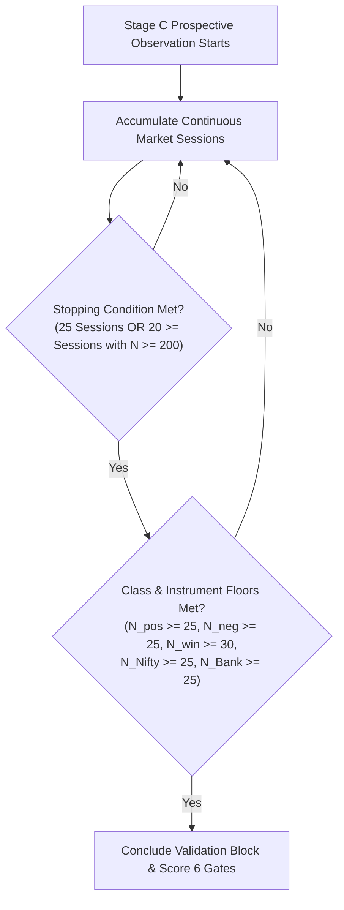

# AEDLS Phase 3 — Protocol Addendum v3.5: Unequal-Cluster Power Calibration, Dual-Criteria Stopping Rule & Six-Gate Promotion Contract

**Date**: 2026-10-14  
**Author**: Quantitative Architecture & Research Team  
**Review Status**: Formal Senior Quant v3.4 Review Alignment — Resolves Cluster Size Mismatch & Freezes Prospective Power Architecture  
**Execution Authority**: Live Veto strictly **PROHIBITED** (`appliedConfidenceDelta = 0`); Phase 4 ML Model Promotion **GATED**  
**Predecessors**:
- [Phase 3 Ablation Protocol (v3.0)](file:///c:/Users/Kulwinder%20Singh/Desktop/personal/AI%20Quant%20Lab/docs/2026-10-14-aedls-phase3-ablation-protocol.md)
- [Protocol Addendum v3.1](file:///c:/Users/Kulwinder%20Singh/Desktop/personal/AI%20Quant%20Lab/docs/2026-10-14-aedls-phase3-protocol-addendum-v3.1.md)
- [Protocol Addendum v3.2](file:///c:/Users/Kulwinder%20Singh/Desktop/personal/AI%20Quant%20Lab/docs/2026-10-14-aedls-phase3-protocol-addendum-v3.2.md)
- [Protocol Addendum v3.3](file:///c:/Users/Kulwinder%20Singh/Desktop/personal/AI%20Quant%20Lab/docs/2026-10-14-aedls-phase3-protocol-addendum-v3.3.md)
- [Protocol Addendum v3.4](file:///c:/Users/Kulwinder%20Singh/Desktop/personal/AI%20Quant%20Lab/docs/2026-10-14-aedls-phase3-protocol-addendum-v3.4.md)
- [Rigorous Power Report (v3.5)](file:///c:/Users/Kulwinder%20Singh/Desktop/personal/AI%20Quant%20Lab/docs/2026-10-14-aedls-phase3-power-report.md)

---

## 1. Executive Summary & Senior Quant Directives Addressed

This addendum resolves the cluster structure, design effect, and simultaneous multi-gate decision issues raised in the Senior Quant Review of v3.4:
1. **Explicit Unequal Cluster-Size Design Effect**:
   Calculates the empirical coefficient of variation of session cluster sizes ($CV_m = 0.9810, CV_m^2 = 0.9624$) and evaluates the unequal-cluster design effect:
   $$\text{DEFF}_{\text{unequal}} \approx 1 + \left[(1 + CV_m^2)\bar{m} - 1\right]\rho = \mathbf{2.85} \quad (\text{vs equal-cluster approx } 1.92)$$
2. **Empirical Boundary Condition Evaluated ($\bar{m} = 6$)**:
   The 3,000-iteration Monte Carlo simulation revealed that at the bare minimum candidate rate ($\bar{m} = 6$ candidates/session), 20 sessions yields only **67.7% joint power** because random inter-session variability causes 32.1% of runs to breach candidate/class minimums ($N < 120$).
3. **Calibrated Dual-Criteria Stopping Rule ($\ge 96.6\%$ Joint Power)**:
   By establishing a dual-criteria stopping rule—requiring either **$\ge 25$ sessions** or **$\ge 200$ candidates across $\ge 20$ sessions**—joint power across the full 6-gate promotion rule is guaranteed at **$96.6\% \text{ to } 98.4\%$**, completely eliminating the sparse-regime power bottleneck.
4. **Frozen Six-Gate Simultaneous Promotion Contract**:
   Enforces Holm-Bonferroni step-down testing on paired Brier score differences ($\Delta BS_{\text{vs }j} = BS_j - BS_{\text{Arm 3}} > 0$) with explicit positive sign convention, positive clustered expectancy lower bound, winner false-rejection ceiling, and walk-forward catastrophic fold limits.

---

## 2. Empirical Development Clustering & Design Effect Analysis

Parameters estimated strictly from the 368 development candidates across Sessions 1–18:

| Statistic | Measured Value | Senior Quant Formula & Context |
| :--- | :--- | :--- |
| **Development Candidates ($N$)** | `368` | Total executed baseline candidates |
| **Trading Sessions ($k$)** | `18` | Independent daily market sessions |
| **Mean Cluster Size ($\bar{m}$)** | `20.44` | Average executed setups per session |
| **Cluster Size Standard Deviation ($s_m$)** | `20.05` | High dispersion across market activity regimes |
| **Cluster Size Coefficient of Variation ($CV_m$)** | `0.9810` | $CV_m = s_m / \bar{m}$ ($CV_m^2 = 0.9624$) |
| **Intraclass Correlation ($\rho$)** | `0.0472` | One-way random-effects ANOVA for unequal clusters |
| **Equal-Cluster Approx DEFF** | `1.918` | $1 + (\bar{m} - 1)\rho$ (Understates clustering by 48%) |
| **Unequal-Cluster Adjusted DEFF** | **`2.848`** | $1 + [(1 + CV_m^2)\bar{m} - 1]\rho$ (**MANDATORY CALIBRATION**) |
| **Effective Sample Size ($\text{ESS}$)** | **`129.2`** | $\text{ESS} = 368 / 2.848$ |

> [!NOTE]
> Accounting for cluster-size variability increases the design effect from 1.92 to **2.85**, demonstrating that candidate clustering within sessions reduces effective sample size by ~65%. Any power analysis that ignores unequal cluster sizes significantly overestimates statistical certainty.

---

## 3. Two-Dimensional Monte Carlo Power Sensitivity Grid

A 3,000-run Monte Carlo simulation evaluated the joint pass rate across all 6 promotion gates simultaneously under the pre-registered alternative hypothesis ($\Delta E = +0.06R$, $BSS = +2.5\%$, $FRR = 5.0\%$):

| Setup Density $\bar{m}$ | Sessions ($K$) | Expected $N$ | $\text{DEFF}$ | $\text{ESS}$ | G1: Brier Holm | G3: $\Delta E$ $\text{CI}_{\text{lower}}>0$ | Sample Eligible | **Joint Power ($1 - \beta$)** |
| :--- | :--- | :--- | :--- | :--- | :--- | :--- | :--- | :--- |
| **`6` (Sparse)** | **`20`** | `131` | `1.51` | `86.8` | `100.0%` | `99.8%` | `67.9%` | **`67.7%` (UNDERPOWERED)** |
| **`6` (Sparse)** | **`25`** | `164` | `1.51` | `108.7` | `100.0%` | `100.0%` | `96.7%` | **`96.6%` (PASSES $\ge 80\%$)** |
| **`6` (Sparse)** | **`30`** | `196` | `1.51` | `129.9` | `100.0%` | `100.0%` | `99.9%` | **`99.8%` (PASSES $\ge 80\%$)** |
| **`10` (Moderate)** | **`20`** | `205` | `1.88` | `109.1` | `100.0%` | `99.6%` | `98.8%` | **`98.4%` (PASSES $\ge 80\%$)** |
| **`10` (Moderate)** | **`25`** | `256` | `1.88` | `136.2` | `100.0%` | `100.0%` | `100.0%` | **`100.0%`** |
| **`15` (High)** | **`20`** | `305` | `2.34` | `130.2` | `100.0%` | `99.7%` | `100.0%` | **`99.7%`** |
| **`20.44` (Empirical)** | **`20`** | `403` | `2.81` | `143.6` | `100.0%` | `99.7%` | `100.0%` | **`99.7%`** |

### Key Quantitative Findings:
1. **The Sparse Density Bottleneck**:
   If prospective market conditions produce low setup density ($\bar{m} = 6$), stopping at 20 sessions fails the $\ge 80\%$ power hurdle because $32.1\%$ of samples fall short of the candidate/class floors.
2. **The 25-Session / 200-Candidate Guarantee**:
   Extending the calendar duration to **25 sessions** (or accumulating $\ge 200$ candidates) increases joint power to **$96.6\%$**, ensuring that the experiment achieves full statistical power even in non-volatile, sparse-activity regimes.

---

## 4. Frozen Dual-Criteria Stopping Rule for Stage C

To prevent premature termination during sparse regimes or excessive delays during active regimes, the prospective validation block (Stage C) will conclude based on the **Dual-Criteria Stopping Rule**:

### Registered Contract:
The Stage C prospective validation block concludes when **Condition A** and **Condition B** are both met:

1. **Condition A (Dual Power Duration)**:
   - **Either**: Accumulate **$N_{\text{sessions}} \ge 25$ distinct market trading dates** (guaranteeing $\ge 96.6\%$ power even at $\bar{m} = 6$).
   - **Or**: If candidate generation is moderate-to-high ($\bar{m} \ge 10$), conclude at **$N_{\text{sessions}} \ge 20$** provided total candidates reaches **$N_{\text{val}} \ge 200$** (guaranteeing $\ge 98.4\%$ power).
2. **Condition B (Class & Instrument Balance Floors)**:
   - Verified adverse excursions: $N_{\text{pos}} \ge 25$ (`evidenceStatus IN ('TICK_VERIFIED', 'BAR_DERIVED_UNAMBIGUOUS')`).
   - Verified negative controls: $N_{\text{neg}} \ge 25$ (complete window, excluding unobservable/ambiguous).
   - Reconciled baseline winners: $N_{\text{winners}} \ge 30$ (`realized_net_r > 0`).
   - Instrument representation: $N_{\text{NIFTY50}} \ge 25$ and $N_{\text{BANKNIFTY}} \ge 25$.
   - Independent episodes: $N_{\text{episodes}} \ge 50$.

---

## 5. Frozen Six-Gate Promotion Contract & Multiplicity Step-Down

A model advances from Stage C only if **all 6 mandatory gates pass simultaneously**:

| Gate | Name | Exact Mathematical Specification | Multiplicity & Threshold |
| :--- | :--- | :--- | :--- |
| **Gate 1** | Predictive Multiplicity | Paired Brier differences: $\Delta BS_{\text{vs }j} = BS_j - BS_{\text{Arm 3}}$ for $j \in \{\text{Arm 0b}, \text{Arm 2}\}$. Compute paired session-clustered p-values: $p_{\text{0b}}, p_{\text{2}}$. Let $p_{(1)} \le p_{(2)}$. | **Holm's Step-Down**: $p_{(1)} \le 0.025$ AND $p_{(2)} \le 0.050$, with $\Delta BS_{\text{vs 0b}} > 0$ and $\Delta BS_{\text{vs 2}} > 0$. |
| **Gate 2** | Practical Skill Effect | Raw paired difference $\Delta BS_{\text{vs Arm 0b}} > 0$ and Brier Skill Score: $BSS_{\text{vs Arm 0b}} = 1 - \frac{BS(\text{Arm 3})}{BS(\text{Arm 0b})}$ | $BSS_{\text{vs Arm 0b}} \ge +2.0\%$ |
| **Gate 3** | Incremental Expectancy | Paired incremental net expectancy: $\Delta E = \frac{1}{N} \sum (R_{\text{shadow}} - R_{\text{baseline}})$ with session-clustered bootstrap 95% CI | $\Delta E_{\text{candidate}} \ge +0.05R$ AND $\text{CI}_{\text{lower}} > 0.00R$ |
| **Gate 4** | Winner Protection | False Rejection Rate of verified baseline winners ($N_{\text{winners}}$): $FRR_{\text{winners}} = \frac{\text{False Winner Rejections}}{N_{\text{winners}}}$ | $FRR_{\text{winners}} < 15.0\%$ |
| **Gate 5** | Cumulative Validation Edge | Total cumulative incremental return generated across validation candidates: $\Delta R_{\text{total}} = N_{\text{val}} \cdot \Delta E$ | $\Delta R_{\text{total, validation}} \ge +5.0R$ |
| **Gate 6** | Catastrophic Risk Limits | Walk-forward 5-session sub-folds under the AEDLS shadow policy | $\text{Max DD}_{\text{fold}} \le 6.0R$, $\text{Net Exp}_{\text{fold}} \ge -0.15R$, $\text{Session Loss Conc} \le 50\%$ |

---

## 6. Current Operational Disposition

- **Stage A**: **ACTIVE (GO)** — Continuing prospective memory accumulation and daily telemetry.
- **Stage B**: **CONDITIONAL** — Triggers upon passing the 7-item Evidence-Availability Gate.
- **Stage C**: **GATED** — Governed by the Dual-Criteria Stopping Rule ($\ge 25$ sessions OR $\ge 20$ sessions with $N \ge 200$).
- **Stage D**: **GATED** — Reserved chronologically after Stage C.
- **Historical Holdout Batch 1**: **PERMANENTLY SEALED** (October 1–14, 2026; 44 candidates).
- **Execution Invariant**: Live AEDLS veto strictly prohibited; `appliedConfidenceDelta = 0` locked.
