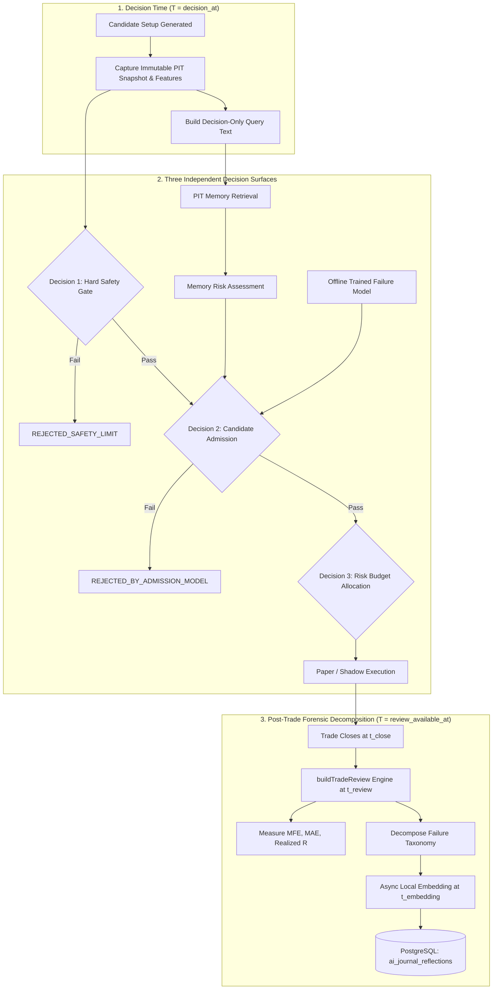
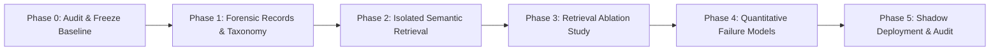

# Adaptive Error-Driven Learning System (AEDLS) Plan v2.0
## Senior Quant Review Harmonization, Empirical Governance & Specification

**Document ID:** `AEDLS-SPEC-v2.0`  
**Revision Date:** 2026-10-14  
**Status:** `RESEARCH & SHADOW-DEVELOPMENT APPROVED — LIVE EXECUTION VETO PROHIBITED`  
**Scope:** AI Autonomous Agent (`ai-autonomous-agent.ts`) & Quantitative Modeling Engines (`apps/ml`)  
**Target Instruments:** NSE Index Derivatives (NIFTY 50 / BANKNIFTY)  
**Governance Hierarchy:** Senior Quant Architecture Review Harmonization  

---

## 1. Executive Disposition & Senior Review Alignment

The Senior Quant Research & Architecture Review granted **conditional approval for research and shadow-mode development**, while strictly **prohibiting live trading authority or live vetoes** (`REJECTED_BY_ERROR_MODEL`) until incremental out-of-sample economic value is proven.

The review confirmed the core strengths of the dual-loop architecture while identifying six critical **P0 deficiencies** in v1.0. This v2.0 specification adopts every correction as a mandatory architectural invariant.

### Summary of Architectural Amendments (v1.0 → v2.0)

| Area | v1.0 Plan Defect | v2.0 Mandated Correction |
| :--- | :--- | :--- |
| **P0.1 Failure Taxonomy** | Mixed observed outcomes, causal guesses, and policy rules into one string (e.g. `ERR_IMMEDIATE_ADVERSE`). | **Decomposed into 3 orthogonal fields**: `observed_failure` (measured fact), `causal_hypothesis` (falsifiable theory), and `attribution_status` (`SUPPORTED`, `REFUTED`, `UNKNOWN`). |
| **P0.2 Label & Selection Bias** | Dropped intermediate trades ($-0.4R$, $+0.6R$) and trained only on executed `paper_trades` (ignoring rejected/unfilled setups). | **Split into Experiment A (General Admission)** over all candidate setups and **Experiment B (Failure-Specific Risk)** over objective adverse events. Attached to the candidate-decision ledger. |
| **P0.3 Validation Hierarchy** | Conflated walk-forward validation with Combinatorial Purged CV (CPCV). | **Primary promotion gate: Chronological Walk-Forward** with purged outcome horizons and embargoes. CPCV is strictly secondary robustness. Catastrophic single-fold drawdowns fail the model. |
| **P0.4 Retrieval Policy** | Assumed arbitrary $0.82$ cosine similarity was a universal similarity boundary. | **Compound Match Policy**: $\text{MemoryMatch} = \text{SemanticMatch} \land \text{StructuralCompatibility}$. Threshold must be calibrated on reviewed pairs and frozen before holdout testing. |
| **P0.5 Confidence Penalty** | Formula produced $0$ at threshold and allowed duplicate episodes to artificially scale penalties up to $-20$. | **Replaced numeric penalty with structured evidence object** (`MemoryRiskAssessment`). `confidenceDelta = 0` until empirical calibration in shadow mode proves positive $\Delta E$. |
| **P0.6 PIT Timestamp Contract** | Used simple `timestamp < $2`, risking review leakage if generated minutes after trade close. | **Strict 3-timestamp availability guard**: $\max(t_{\text{close}}, t_{\text{review}}, t_{\text{embedding}}) < T_{\text{decision}}$. Query text restricted strictly to decision-time context. |

---

## 2. System Architecture & The Three Independent Decisions

The system enforces a clean separation of concerns. AEDLS components hold **zero order-placement or risk-authorizing authority**.



### The Three Independent Decisions
1. **Safety Decision (Execution & Risk Controls):** Hard spread limits, data freshness, max drawdown limits, and broker boundaries. Handled by the core risk engine.
2. **Admission Decision (AEDLS Meta-Policy):** Evaluates whether an approved, independently validated model or memory policy rejects the candidate. **Passing AEDLS never authorizes a trade; it only permits consideration.**
3. **Risk Decision (Position Sizing):** Allocates lot-rounded sizing based strictly on the portfolio risk budget. AEDLS cannot increase risk.

---

## 3. P0 Schema Corrections: Failure Taxonomy & PIT Contracts

### 3.1 Forensic Review Schema (`TradeFailureReview`)

To prevent training models on speculative diagnoses, reviews strictly separate what happened from why it might have happened:

```typescript
export interface TradeFailureReview {
  tradeId: string;
  candidateId: string;
  
  // 1. Directly measured market events (objective fact)
  observedFailure: 
    | "IMMEDIATE_ADVERSE_EXCURSION"   // MAE >= 1.0R within 3 bars while MFE < 0.2R
    | "FAVORABLE_STALL_REVERSAL"      // MFE >= 1.0R, then closed at Stop Loss
    | "PREMIUM_DIVERGENCE_TRAP"       // Spot moved >= 0.05% in favor, Option P&L <= 0
    | "EXCESSIVE_SPREAD_SLIPPAGE"     // Slippage + spread exceeded 0.5R
    | "CLEAN_STOP_OUT"                // Normal loss without anomalous excursion
    | "NONE_PROFITABLE";              // Clean win or target reached

  // 2. Falsifiable causal hypotheses
  causalHypothesis:
    | "OPPOSING_ORDER_FLOW"           // Active seller delta absorbed buyer initiative
    | "VOLATILITY_CRUSH_VEGA"         // IV contracted sharply post-entry
    | "LIQUIDITY_VACUUM_SLIP"         // Top-of-book depth evaporated at fill
    | "COUNTER_DRIVER_TAPE"           // Trade opposed 15m/1h macro driver tape
    | "UNATTRIBUTED_MARKET_VARIANCE"; // Random market noise / ordinary variance

  // 3. Rigorous attribution status
  attributionStatus: "SUPPORTED" | "REFUTED" | "UNKNOWN";

  // 4. Exact availability timestamps (Strict PIT Guards)
  tradeClosedAt: string;              // ISO-8601 when position closed
  evidenceAvailableAt: string;       // ISO-8601 when holding-period data settled
  reviewAvailableAt: string;         // ISO-8601 when review script finished
  embeddingAvailableAt: string | null;// ISO-8601 when vector was written

  // 5. Versioning
  taxonomyVersion: "taxonomy-v2.0";
  reviewerVersion: "reviewer-v2.0";
  proposedResearchTags: string[];
}
```

### 3.2 Strict Point-in-Time Database Query

When evaluating an incoming candidate setup at timestamp $T_{\text{decision}}$, the SQL query must prevent any future review, embedding, or closed trade from leaking into the retrieval corpus:

```sql
SELECT 
    r.id,
    r.trade_id,
    r.observed_failure,
    r.causal_hypothesis,
    r.attribution_status,
    r.structural_context,
    1 - (r.embedding <=> $1) AS semantic_similarity
FROM ai_journal_reflections r
WHERE r.trade_closed_at < $2
  AND r.review_available_at < $2
  AND r.embedding_available_at < $2
  AND r.embedding IS NOT NULL
  AND 1 - (r.embedding <=> $1) >= $3 -- Experimental similarity floor
ORDER BY r.embedding <=> $1 ASC
LIMIT 10;
```

> [!IMPORTANT]
> `$2` is the immutable **candidate decision timestamp**, not the execution time of a backtest script. Query embeddings must be synthesized exclusively from features available at $T_{\text{decision}}$.

---

## 4. Compound Memory Match & Risk Policy

An embedding model measures language proximity, not market equivalence. Language describing a failed long at VAL heavily overlaps with language describing a successful long at VAL. 

Therefore, memory retrieval requires **Compound Matching**:
$$\text{MemoryMatch} = \text{SemanticMatch} \land \text{StructuralCompatibility}$$

### Structural Compatibility Matrix

| Dimension | Exact Match Required? | Permitted Tolerance |
| :--- | :--- | :--- |
| **Instrument** | Yes | Must be identical underlying (`NIFTY50` vs `NIFTY50`). |
| **Trade Side** | Yes | `LONG` only matches `LONG`; `SHORT` only matches `SHORT`. |
| **Setup Family** | Yes | Reversal only matches Reversal; Breakout only matches Breakout. |
| **Regime** | Partial | Balanced matches Balanced; Directional matches Directional. |
| **Excursion Type**| Categorical | Filter by `observed_failure` (e.g. `IMMEDIATE_ADVERSE_EXCURSION`). |

### Deduplicated Structured Evidence Output

The memory retriever returns structured evidence, **never an uncalibrated numeric penalty**:

```typescript
export interface MemoryRiskAssessment {
  status: "NO_MATCH" | "MATCH_UNVALIDATED" | "MATCH_VALIDATED";
  matchedReviewIds: string[];
  deduplicatedEventCount: number;      // Collapses repeated reviews of same episode
  maxSemanticSimilarity: number;
  structuralCompatibilityScore: number;
  dominantObservedFailure: string | null;
  confidenceDelta: number;             // MUST BE 0.0 IN SHADOW MODE
  reasonCodes: string[];
}
```

* **Deduplication Rule**: If 3 matching reflections belong to trades opened within the same 30-minute market window on the same day, they are treated as **1 single market episode**.
* **Zero Initial Impact**: `confidenceDelta` remains locked at `0.0` until Phase 3 ablation proves that non-zero adjustments yield positive incremental net expectancy.

---

## 5. Machine Learning Experiment Decoupling

Rather than training a single classifier on an arbitrarily pruned dataset ($R \ge +1R$ vs selected failure codes), AEDLS v2.0 separates the research into two independent experiments:

### Experiment A: General Candidate Admission Model
* **Research Question**: Does any feature combination predict whether a candidate setup achieves a net positive expectancy ($R_{\text{net}} > 0$) after all modeled slippage, brokerage, and taxes?
* **Population**: **All eligible candidate setups** from the decision ledger (including setups where orders were rejected, expired, or timed out).
* **Target Label**:
  $$Y_{\text{adm}} = \begin{cases} 1 & \text{if Realized Net } R > 0 \\ 0 & \text{if Realized Net } R \le 0 \end{cases}$$
* **Benchmark Baseline**: Compare against unconditional acceptance and a simple linear/logistic model.

### Experiment B: Failure-Specific Risk Model
* **Research Question**: Can decision-time microstructure features identify when a setup has an elevated probability of experiencing `IMMEDIATE_ADVERSE_EXCURSION` ($\text{MAE} \ge 1.0R$ within 3 bars)?
* **Population**: All executed setups.
* **Target Label**:
  $$Y_{\text{adverse}} = \begin{cases} 1 & \text{if } \text{observed\_failure} = \text{IMMEDIATE\_ADVERSE\_EXCURSION} \\ 0 & \text{otherwise} \end{cases}$$
* **Model Objective**: Predict elevated probability of severe adverse selection to trigger a veto or position reduction.

---

## 6. Measurable Promotion Gates (Gates A – E)

A model or memory policy can only advance through strict sequential gates:

```text
GATE A: Data & PIT Integrity
   │ (Zero leakage, verified review/embedding availability timestamps)
   ▼
GATE B: Failure-Label Reliability
   │ (Deterministic excursion math, reproducible taxonomy classification)
   ▼
GATE C: Retrieval Usefulness
   │ (Precision/recall on reviewed pairs, compound structural compatibility)
   ▼
GATE D: Incremental Economic Value
   │ (ΔE = E[R_policy, net] - E[R_baseline, net] > 0 across walk-forward folds)
   ▼
GATE E: Shadow Deployment & Controlled Promotion
   │ (Logged shadow recommendations, zero unmonitored live authority)
```

### Economic Evaluation Formula (Gate D)
The primary metric is **Incremental Net Expectancy per Candidate** ($\Delta E$):
$$\Delta E = E\left[R_{\text{AEDLS policy, net}}\right] - E\left[R_{\text{baseline policy, net}}\right]$$

* Evaluated on paired chronological holdout sessions using day-clustered bootstrap confidence intervals.
* Must account for friction: include rejected candidate counterfactuals, model slippage, and STT/exchange fee drag.
* **Failure Rule**: A model with positive aggregate mean $R$ that suffers a catastrophic drawdown in any single walk-forward fold remains `BLOCKED`.

---

## 7. Revised Implementation Roadmap

Implementation follows a strict staged sequence where each stage must meet its exit criteria before the next begins:



### Phase 0: System Audit & Baseline Freeze
* Map data flows in `ai-autonomous-agent.ts`, `apps/ml`, and database tables.
* Reconcile all decision timestamps in `paper_trades` and `trade_ideas`.
* **Exit Criterion**: Frozen baseline performance metrics documented; regression tests prove baseline behavior is unchanged.

### Phase 1: Forensic Records & Decomposed Taxonomy
* Implement `TradeFailureReview` schema and deterministic MFE/MAE excursion calculations in `PostgresTradeReviewRepository`.
* Migrate `ai_journal_reflections` to store `observed_failure`, `causal_hypothesis`, `attribution_status`, and PIT availability timestamps.
* **Exit Criterion**: 100% of historical closed trades re-evaluated produce deterministic, reproducible taxonomy records.

### Phase 2: Isolated Semantic Retrieval Pipeline
* Integrate `@xenova/transformers` (`all-MiniLM-L6-v2`) running locally via ONNX.
* Implement asynchronous embedding worker on trade close (never blocking execution).
* Add compound structural filter (`SemanticMatch` $\land$ `StructuralCompatibility`).
* **Exit Criterion**: Retrieval latency measured (p95 $< 30\text{ms}$); zero leakage on historical PIT queries; zero live trading impact.

### Phase 3: Retrieval Ablation Study
* Replay historical candidate setups through the memory retriever in shadow mode.
* Measure whether retrieved memories correlate with actual subsequent trade outcomes.
* Calibrate the similarity floor and evaluate if a non-zero `confidenceDelta` provides any statistical separation.
* **Exit Criterion**: Documented statistical evidence showing whether memory retrieval adds predictive value over the memory-free baseline.

### Phase 4: Quantitative Failure Models (Exp A & Exp B)
* Construct candidate-level datasets with strict separation of admission and adverse-selection targets.
* Run chronological 5-fold walk-forward validation with purged horizons and embargoes.
* Benchmark against trivial majority and regularized linear baselines before testing boosted models.
* **Exit Criterion**: Model passes Gate D with statistically significant $\Delta E > 0$ after full transaction costs.

### Phase 5: Shadow Deployment & Promotion Review
* Deploy the validated policy into live paper/shadow execution.
* Log all model outputs, memory matches, and counterfactual decisions without altering live order routing.
* **Exit Criterion**: Shadow performance replicates out-of-sample backtest expectations over a minimum of 4 weeks / 100 candidate events before promotion review.

---

## 8. Final Governance Invariants

1. **Current State Always Overrides Memory**: A historical reflection cannot override a current structural price invalidation, order-book imbalance conflict, or risk limit.
2. **Advisory Fail-Safe**: If the embedding worker, vector database, or meta-model service crashes or times out, the system outputs `MODEL_UNAVAILABLE`. An inference failure never acts as a veto, never fabricates a trade, and leaves candidate evaluation to the frozen baseline and independent risk engine.
3. **Immutable History**: If a forensic diagnosis is updated, a new versioned record is appended with its own `reviewAvailableAt` timestamp. Historical decisions remain evaluated against what was known at that exact moment.
4. **Research Only**: `REJECTED_BY_ERROR_MODEL` remains an advisory diagnostic flag until formal sign-off under Gate E.

---

## 9. v2.1 Senior Quant Review Amendments

### 9.1 Candidate Decision Ledger vs Executed Trade Outcomes (P0.1)
Unexecuted candidates (rejected, expired, or timed-out setups) do not possess an observed trading return. To prevent selection bias without fabricating fills, the candidate decision ledger records three distinct fields:
* `observed_execution_outcome`: Actual order lifecycle outcome (`FILLED`, `UNFILLED_TIMEOUT`, `REJECTED_RISK_CAP`, `REJECTED_SAFETY_LIMIT`, `EXPIRED_UNTRIGGERED`).
* `counterfactual_outcome`: Modeled economic outcome under the registered execution policy, populated **only** if executable liquidity and quotes were provably available.
* `counterfactual_validity`: Enum (`VALID_SIMULATED`, `INSUFFICIENT_DEPTH`, `NON_EXECUTABLE_SPREAD`, `NOT_APPLICABLE`).
* **Rule**: The admission model (Experiment A) predicts candidate viability using only valid executable counterfactuals or explicit candidate classes, never by assigning arbitrary $R = 0$ or synthetic losses.

### 9.2 Precise Excursion Geometry & Edge-Case Semantics (P0.2)
1. **Window Definition for `IMMEDIATE_ADVERSE_EXCURSION`**:
   - The 3-bar window begins **strictly on the completed bars immediately following the entry timestamp** (excluding the entry bar itself to prevent lookback conflation).
2. **Intrabar Ambiguity Resolution**:
   - If a bar touches both the stop distance ($1.0R$) and the favorable threshold ($0.2R$) and intrabar tick order is unverified, apply the conservative principle: **assume the adverse excursion occurred first**.
3. **Option vs Underlying Separation**:
   - For option contracts, excursions must be recorded on the **option premium series** directly (`option_mark_to_market.ts`), not the underlying index. Underlying moves are recorded separately as `underlying_excursion_points`.
4. **Decoupling `FAVORABLE_STALL_REVERSAL`**:
   - Recorded strictly as an excursion trajectory ($MFE \ge 1.0R$, followed by drawdown to original stop). It is tagged as an objective path, not an automatic strategy defect (since breakeven management may be intentional).

### 9.3 Resolution of Operational Fallback States (P0.3)
To resolve any ambiguity between research advisories and safety gates:
* While AEDLS is in research/shadow mode, an infrastructure or inference failure outputs **`MODEL_UNAVAILABLE`** (distinct from `NO_MATCH`).
* Under `MODEL_UNAVAILABLE`, the candidate follows the frozen baseline strategy and the independent risk engine without modification.
* An inference failure is never logged as a positive recommendation, and an optional research advisory cannot silently block baseline trading.

### 9.4 Empirical Episode Deduplication (P0.4)
* Instead of an arbitrary 30-minute window, trades are assigned an `episode_id` derived from persistent market states (continuous volatility regime or same-day price bracket).
* The memory retriever outputs both `raw_review_count` and `deduplicated_episode_count`.
* The sensitivity of retrieval metrics to alternative clustering windows (15m, 30m, 60m) must be reported in Phase 3.

### 9.5 Objective Economic Target & Catastrophic Fold Limits (P0.5)
1. **Secondary Economic Objective**:
   - In addition to binary admission classification ($Y_{\text{adm}} = \mathbf{1}[R_{\text{net}} > 0]$), Experiment A adds a continuous conditional expected return objective:
     $$\hat{E}[R_{\text{net}} \mid X]$$
   - This ensures the model distinguishes between high-win-rate/low-payoff setups and moderate-win-rate/high-payoff setups.
2. **Frozen Definition of a Catastrophic Fold**:
   A model is strictly disqualified if **any single walk-forward fold** breaches any of the following boundaries, regardless of aggregate mean performance:
   - Maximum single-fold drawdown $> 6.0R$.
   - Single-fold net expectancy $< -0.15R$.
   - Single-session loss concentration $> 50\%$ of the fold's total gross losses.
   - Effective candidate sample size $< 40$ setups in the fold.

### 9.6 Hardened Gate D & Gate E Operational Standards
* **Gate D Research Standard**: The paired policy incremental net expectancy ($\Delta E$) must have a **95% session-clustered bootstrap confidence interval whose lower bound strictly exceeds zero** ($\text{CI}_{\text{lower}} > 0$). If the interval includes zero, the result is `INCONCLUSIVE`.
* **Gate E Shadow Standard**: Minimum 4 weeks and 100 candidate events are necessary conditions for observation, not proof of alpha. Operational promotion requires:
  - Feature distribution shift stability (Kolmogorov-Smirnov test $p > 0.05$).
  - Full reconciliation of live shadow outputs against frozen research artifacts.
  - A documented rollback script and explicit operator sign-off.

